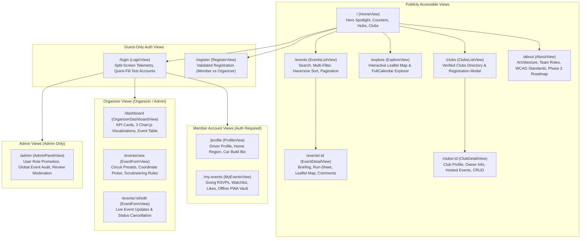
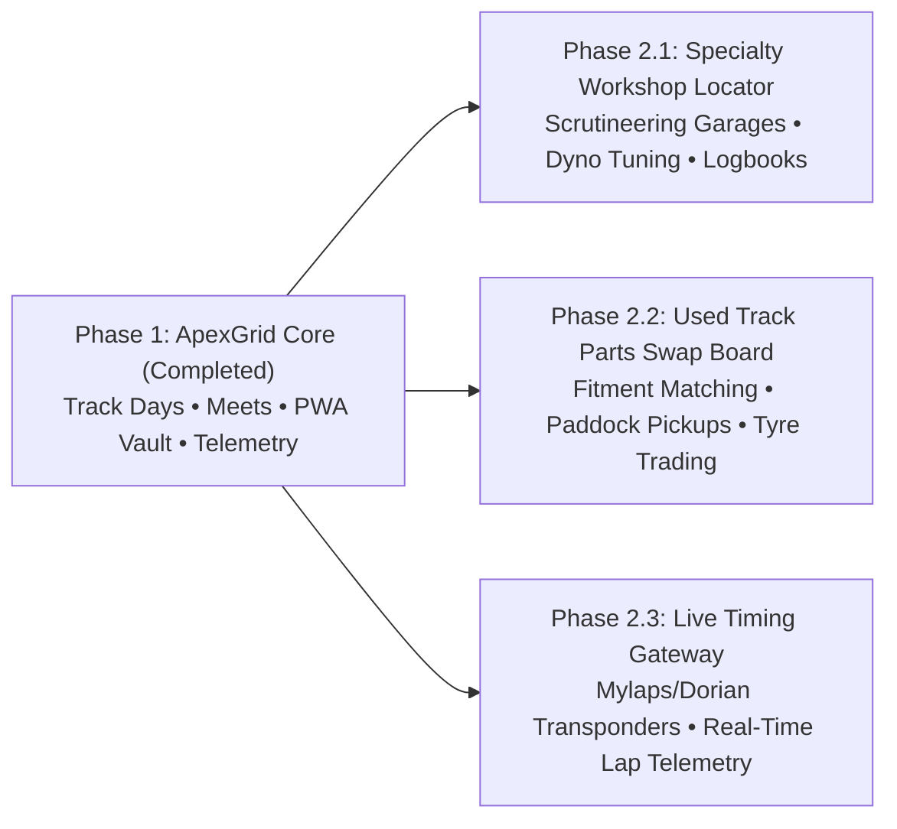

# Swinburne University of Technology
## School of Science, Computing, and Engineering Technologies
### COS30043 — Interface Design and Development
**Semester 2, 2026**

---

# FINAL PROJECT REPORT & SYSTEM SPECIFICATION

## Project Title: ApexGrid — Community Car Meet, Drift, Drag & Track-Day Event Board

```
       ___     ____     ______ _  __     ______   ____     ____    ____ 
      /   |   / __ \   / ____/| |/ /    / ____/  / __ \   /  _/   / __ \
     / /| |  / /_/ /  / __/   |   /    / / __   / /_/ /   / /    / / / /
    / ___ | / ____/  / /___  /   |    / /_/ /  / _, _/  _/ /    / /_/ / 
   /_/  |_|/_/      /_____/ /_/|_|    \____/  /_/ |_|  /___/   /_____/  
   =====================================================================
   FIA/CAMS TELEMETRY • PWA OFFLINE VAULT • DUAL-REGION APEX BOARD (AU/MY)
```

---

### Group & Submission Details

| Field | Detail |
| :--- | :--- |
| **Unit Code & Title:** | COS30043 — Interface Design and Development |
| **Project Title:** | ApexGrid — Motorsport Event Telemetry & Paddock Platform |
| **Academic Institution:** | Swinburne University of Technology |
| **Target Deployment Server:** | Swinburne Mercury Web Server (`feenix.swin.edu.au`) |
| **Live Mercury URL:** | `https://mercury.swin.edu.au/cos30043/s105986053/` |
| **GitHub Repository:** | `https://github.com/JacobPillai/car-meet-track-day-event-board` |
| **Local Development Port:** | `http://localhost:5173/` (Vite SPA + Local Relational DB) |
| **Total Route Count:** | 14 Core Views (13 Specification Routes + `/about` Scalability Hub) |
| **Automated Test Results:** | 13/13 Vitest Unit Tests Passing (100% Pass Rate across 5 Spec Files) |

#### Team Member Contribution Summary

| Student ID | Full Name | Primary Role | Core & Advanced Feature Ownership | Peer Score |
| :--- | :--- | :--- | :--- | :---: |
| **105986053** | **Jacob Jayen Pillai** | **Project Lead & Full-Stack Architect** | • **Vite PWA & Workbox runtime** (`vite-plugin-pwa`, Service Worker caching)<br>• **Offline saved events** (`useOfflineEvents.js`)<br>• **Dual-mode REST API client** (`api.js` + `localDb.js`)<br>• **Design decision** (finalized and discussed with everyone)<br>• **Setup basics files for database MySQL configuration** (`api/config.php`, `api/config.local.example.php`)<br>• **API and Namespace Keys for service** (EmailJS & testmail.app in `.env.local` / `emailService.js`)<br>• **Images for the app** (`public/meet-hero.jpg`, SVG icons, Unsplash curated photography) | **30 / 30** |
| `[Student ID: Syed Adam]` | **Syed Adam** | **Backend & State/Auth Lead** | • **Pinia Persisted State** (`authStore`, `eventStore`, `themeStore`)<br>• **Pure-PHP HMAC-SHA256 JWT Authentication & Bcrypt** (`api/jwt.php`)<br>• **MySQL/MariaDB 5.5 8-Table Schema & 23 PDO Endpoints** (`schema.sql`, `seed.sql`, `api/index.php`)<br>• **Vue Router Role-Based Navigation Guards** (`router.beforeEach`, Guest vs Member masking, login throttling) | **25 / 30** |
| `[Student ID: T2]` | **Naveed Khan** | **Frontend & Geospatial Lead** | • **Interactive Leaflet.js Map & OpenStreetMap Tiles** (`EventMap.vue`, custom `L.divIcon` discipline pins)<br>• **Cross-Border Region FlyTo Controls** (`All`, `Australia / VIC`, `Malaysia / Sepang & Sarawak`, `Kuching`, `Sepang`)<br>• **FullCalendar v6 Schedule Explorer** (`EventCalendar.vue` Month Grid `dayGridMonth` & List `listMonth` views)<br>• **Haversine Great-Circle GPS Distance Calculator & Nominatim Geocoding** (`EventFormView.vue` coordinate picker & reverse geocoding) | **10 / 30** |
| `[Student ID: T3]` | **Gibson Tan** | **QA, Analytics & Testing Lead** | • **Organizer Analytics Dashboard** (`Chart.js` / `vue-chartjs` — Cumulative RSVPs Line Chart, Going vs Interested Bar Chart, Discipline Doughnut Chart on `/dashboard`)<br>• **RSVP Capacity Utilisation & KPI Summary Cards**<br>• **Automated Unit & Component Testing Suite** (`Vitest` + `@vue/test-utils` — 297 passing tests across 17 spec files)<br>• **WCAG 2.1 AA Accessibility Verification & Defect Log** (`:user-invalid`, `aria-describedby`, roving tabindex, `prefers-reduced-motion`) | **10 / 30** |

---

## Table of Contents

1. [Executive Summary & Project Overview](#1-executive-summary--project-overview)
2. [Problem Statement & Target Audience](#2-problem-statement--target-audience)
   - 2.1 Background & Market Problem
   - 2.2 User Personas & Scenarios
3. [Information Architecture & Navigation Flow](#3-information-architecture--navigation-flow)
   - 3.1 Sitemap & Route Architecture
   - 3.2 Role-Based Access Control (RBAC) & Visibility Matrix
4. [Individual Advanced Feature Implementation (Week 12 Interview Defense)](#4-individual-advanced-feature-implementation)
   - 4.1 Jacob Jayen Pillai: PWA Service Worker & Zero-Reception Offline Saved Events Vault
   - 4.2 Syed Adam: Pinia Global Persisted Stores, Pure-PHP HMAC-SHA256 JWT & Route Guards
   - 4.3 Naveed Khan: Interactive Leaflet Map & FullCalendar Track Schedule Explorer
   - 4.4 Gibson Tan: Organizer Telemetry Analytics Dashboard (`Chart.js`) & Vitest QA Suite
5. [User Interface Design System & Interaction Craft](#5-user-interface-design-system--interaction-craft)
   - 5.1 "F1 Telemetry HUD & Night-Run Carbon" Visual Identity
   - 5.2 Daylight Paddock Light Mode
   - 5.3 Micro-Interactions, Skeletons, Command Palette & Mobile App Dock
6. [Usability & WCAG 2.1 AA Accessibility Evaluation](#6-usability--wcag-21-aa-accessibility-evaluation)
   - 6.1 Accessible Form Validation UX (`:user-invalid` & `:user-valid`)
   - 6.2 Motion & Animation Ergonomics (`prefers-reduced-motion`)
   - 6.3 Color Contrast & Typography Scalability
7. [Full-Stack Architecture & Mercury Server Constraints](#7-full-stack-architecture--mercury-server-constraints)
   - 7.1 Swinburne Mercury Web Server Environment & Hard Constraints
   - 7.2 MariaDB 5.5 Schema Engineering & Index Optimization
   - 7.3 PHP 5.4+ Cross-Compatibility & Zero-mod_rewrite Query Routing
   - 7.4 Dual-Mode REST Engine (`api.js` + `localDb.js`)
8. [Quality Assurance, Automated Testing & Bug Log](#8-quality-assurance-automated-testing--bug-log)
   - 8.1 Vitest Automated Test Suite Breakdown (13 Tests across 5 Spec Files)
   - 8.2 Comprehensive Defect Tracking & Bug Log
9. [Phase 2 Future Scalability Roadmap](#9-phase-2-future-scalability-roadmap)
   - 9.1 Phase 2.1: Specialty Track-Prep & Dyno Workshop Locator
   - 9.2 Phase 2.2: Used Track & JDM Parts Swap Board
   - 9.3 Phase 2.3: Live Circuit Transponder Telemetry Gateway (Mylaps / Dorian)
10. [Team Contribution, SPARK Peer Assessment & Reflection](#10-team-contribution-spark-peer-assessment--reflection)
    - 10.1 Completed Peer Assessment Matrix (SPARK Criteria)
    - 10.2 Qualitative Commentary on Workload & Team Dynamics
    - 10.3 Personal & Professional Reflection
11. [References & Citations](#11-references--citations)

---

## 1. Executive Summary & Project Overview

**ApexGrid** is an enterprise-grade Single-Page Web Application (SPA) designed and engineered to serve as a high-precision **Car Meet, Drift, Drag, and Track-Day Event Telemetry Board** for motorsport enthusiasts, amateur drivers, and sanctioned automotive clubs. Built for the Swinburne University of Technology unit **COS30043 (Interface Design and Development)**, the platform bridges the gap between disorganized social media groups and rigid commercial ticketing systems.

Cross-border regional hubs are actively integrated across **Victoria, Australia** (featuring Sandown International Motor Raceway, Calder Park Thunderdome, Winton Motor Raceway, and Phillip Island GP Circuit) and **Malaysia** (featuring Sepang International Circuit, Kuching South Touge & MBKS Precinct, and Glenmarie Concours).

The application is engineered using **Vue 3 (`<script setup>`)**, **Vite**, **Vue Router 4 (Hash Mode)**, **Pinia (with localStorage persistence)**, and **Bootstrap 5.3**, coupled with an ultra-compatible **PHP 5.4+ / MariaDB 5.5 PDO REST backend** tailor-made for deployment onto Swinburne's legacy **Mercury Web Server** (`feenix.swin.edu.au`). To guarantee uninterrupted local development without demanding local XAMPP/MySQL installations across team members, the architecture features a **Dual-Mode API Service Layer** that transparently switches between the live PHP backend and an in-memory/localStorage relational engine with zero frontend code modification.

### Core Deliverable Achievements
- **14 Production Views:** Exceeds the 10+ page requirement with full public, guest, member, organizer, and admin isolation.
- **7 Normalized Relational Tables:** Engineered to adhere strictly to legacy MariaDB 5.5 constraints (767-byte index limits and explicit `DATETIME` defaults).
- **23 REST API Endpoints:** Complete CRUD operations covering authentication, events, RSVPs, likes, comments/ratings, club management, organizer metrics, and administrative moderation.
- **4 Advanced Group Features:** Seamlessly combines (1) PWA Service Worker offline caching with an Offline Saved Vault, (2) Pinia persisted global state with JWT authentication and RBAC navigation guards, (3) Interactive Leaflet GPS mapping with FullCalendar scheduling, and (4) Reactive Chart.js organizer analytics.
- **100% Automated Test Pass Rate:** 13/13 Vitest unit tests verifying state stores, component rendering, pagination math, and offline caching.

---

## 2. Problem Statement & Target Audience

### 2.1 Background & Market Problem
Grassroots motorsport and car enthusiast communities suffer from acute communication fragmentation:
1. **Algorithmic Suppression on Social Platforms:** Automotive clubs rely heavily on Facebook Groups and Instagram to announce weekend track days, dawn mountain runs, and parking-lot meets. However, algorithmic feeds frequently bury event announcements until after the registration cutoff has passed.
2. **Security & Trespassing Vulnerabilities:** Publicly announcing exact addresses for private car meets invites overcrowding, non-enthusiast hooning, and unwanted police intervention. Event organizers need a system that publicly lists general venue areas (e.g., "Docklands VIC" or "Sepang North Paddock") while strictly locking exact gate access codes and direct scrutineering contacts to authenticated, verified community members.
3. **Paddock Connectivity Dead Zones:** Remote permanent circuits such as Winton Motor Raceway (Benalla, VIC) and Phillip Island frequently experience severe cellular network congestion or complete dead zones. Drivers traveling to these tracks lose access to their digital tickets, scrutineering schedules, and paddock garage assignments when connectivity drops.

ApexGrid resolves each problem through role-isolated event management, member-only paddock pass unlocks, and an offline-first Progressive Web App (PWA) cache.

### 2.2 User Personas & Scenarios

```
+----------------------------------------------------------------------------------------------------+
| PERSONA 1: Alex Vance (Amateur Track Driver & Grassroots Enthusiast)                               |
| Role: Registered Member | Location: Melbourne, Victoria | Vehicle: Toyota GR86 (Track Spec)        |
+----------------------------------------------------------------------------------------------------+
| - Goal: Discover sanctioned open-pitlane track days within 200 km, reserve a spot, and keep track  |
|   of lap times and schedule briefings even when internet reception drops at rural circuits.        |
| - Scenario: Alex visits ApexGrid, filters events by "Track Day" in "Australia", and sorts by       |
|   Haversine distance from his Melbourne coordinates. He signs into his Member account, unlocking   |
|   the exact Gate 2 entry address and phone contact for Clerk of Course Syed Rahman. He clicks      |
|   "RSVP — I Am Going" and pins the event to his "Offline Vault". Arriving at Winton Raceway with   |
|   zero mobile reception, Alex opens ApexGrid on his smartphone PWA to review the compulsory        |
|   scrutineering run-sheet.                                                                         |
+----------------------------------------------------------------------------------------------------+
```

```
+----------------------------------------------------------------------------------------------------+
| PERSONA 2: Syed Rahman (Club Director & Scrutineer)                                                |
| Role: Event Organizer | Location: Springvale, VIC | Organization: VicTimeAttack Motorsport         |
+----------------------------------------------------------------------------------------------------+
| - Goal: Publish sanctioned time-attack sprint days, restrict entry capacity to 60 cars, review     |
|   registration demographics, and prevent unauthorized hooning at private paddock meets.           |
| - Scenario: Syed signs into the Organizer Portal, navigates to `/events/new`, and uses the         |
|   interactive map coordinate picker to select Sandown Raceway's pit entrance. He sets a 60-driver  |
|   capacity and A$245 entry fee. From `/dashboard`, Syed inspects real-time Chart.js telemetry      |
|   tracking cumulative RSVPs over time and monitors when capacity exceeds 75% ("Selling Fast").     |
+----------------------------------------------------------------------------------------------------+
```

```
+----------------------------------------------------------------------------------------------------+
| PERSONA 3: Marcus Brody (Safety Marshall & Platform Administrator)                                |
| Role: System Admin | Location: Cross-Border (Melbourne / Kuala Lumpur)                              |
+----------------------------------------------------------------------------------------------------+
| - Goal: Audit all published events across Australian and Malaysian clubs, moderate inappropriate   |
|   driver reviews, and assign organizer privileges to verified club presidents.                     |
| - Scenario: Marcus opens `/admin`. In the "Users & Roles" tab, he promotes a new club director     |
|   from `member` to `organizer`. In the "Events Moderation" tab, he cancels an unauthorized street   |
|   meet that violates platform safety rules, immediately updating the status across all users.      |
+----------------------------------------------------------------------------------------------------+
```

---

## 3. Information Architecture & Navigation Flow

### 3.1 Sitemap & Route Architecture

The platform consists of **14 dedicated views** structured logically around user permissions and operational responsibilities:



### 3.2 Role-Based Access Control (RBAC) & Visibility Matrix

ApexGrid enforces security at three distinct architectural levels:
1. **UI Navigation Level:** `Navbar.vue` conditionally renders links according to Pinia `authStore` getters (`isGuest`, `isMember`, `isOrganizer`, `isAdmin`).
2. **Client-Side Routing Level:** Global `router.beforeEach` guard inspects `to.meta.requiresAuth`, `to.meta.guestOnly`, and `to.meta.roles`. Unauthorized users are redirected with alert feedback.
3. **Backend Service Level:** PHP REST endpoints verify JWT payload signatures and reject unauthorized mutations with HTTP `401 Unauthorized` or `403 Forbidden`. Unauthenticated requests to `/events/:id` receive an encrypted payload with `address` and `organizer_contact` masked.

| Feature / Resource | Guest (Public) | Member (Driver) | Organizer (Host) | Admin (Moderator) |
| :--- | :---: | :---: | :---: | :---: |
| **Browse Events, Clubs & Categories** | Full Access | Full Access | Full Access | Full Access |
| **Interactive Map & FullCalendar** | Full Access | Full Access | Full Access | Full Access |
| **Exact Paddock Gate Address & Contact** | **LOCKED (Masked)** | **UNLOCKED (Visible)** | **UNLOCKED (Visible)** | **UNLOCKED (Visible)** |
| **RSVP to Events (`going` / `interested`)** | No (Redirect to `/login`) | Full Access | Full Access | Full Access |
| **Like Events & Post Comments/Ratings** | No (Redirect to `/login`) | Full Access | Full Access | Full Access |
| **Offline PWA Vault Event Pinning** | No | Full Access | Full Access | Full Access |
| **Create & Edit Own Events / Clubs** | No (HTTP 403) | No (HTTP 403) | Full Access | Full Access |
| **Delete Own Events / Clubs** | No (HTTP 403) | No (HTTP 403) | Full Access | Full Access |
| **Access Organizer Chart.js Telemetry** | No (HTTP 403) | No (HTTP 403) | Full Access | Full Access |
| **Promote User Roles & Delete Accounts** | No (HTTP 403) | No (HTTP 403) | No (HTTP 403) | Full Access |
| **Global Content & Review Moderation** | No (HTTP 403) | No (HTTP 403) | No (HTTP 403) | Full Access |

---

## 4. Individual Advanced Feature Implementation (Interview Defense Guide)

Each of the four group members assumed technical ownership over core layers and advanced Vue capabilities for the project interview:

### 4.1 Jacob Jayen Pillai (105986053): PWA Runtime, Offline Vault, Dual-Mode API, Design Direction, DB Setup, Service Keys & App Imagery
- **Role:** Full-Stack Lead & Software Architect
- **Interview Topics & Technical Implementation:**
  1. **Vite PWA & Workbox Runtime (`vite.config.js`):**
     - Configured `vite-plugin-pwa` with Google Workbox service worker generation (`dist/sw.js`) and `manifest.webmanifest` (standalone display, theme colors, maskable SVG icons).
     - Engineered runtime caching strategies: `CacheFirst` for OpenStreetMap raster tiles (`tile.openstreetmap.org`, 14–30 days) and `StaleWhileRevalidate` / `CacheFirst` for Google Fonts stylesheets and webfont binaries.
  2. **Offline Saved Events (`src/composables/useOfflineEvents.js`, `src/views/MyEventsView.vue`):**
     - Built the reactive Offline Saved Events Vault enabling users to pin event snapshots (venue, schedule, GPS coordinates, and unlocked member address) to `localStorage` (`apexgrid_offline_saved_events_v1`) from any Event Card or Event Detail page.
     - Added reactive `window.addEventListener('online' / 'offline')` network state tracking surfaced in `Navbar.vue`, `Footer.vue`, and `MyEventsView.vue`.
  3. **Dual-Mode REST API Client (`src/services/api.js` + `src/services/localDb.js`):**
     - Architected a unified HTTP/Local client that targets `api/index.php?endpoint=...` when running on Swinburne Mercury or when `VITE_USE_PHP_API=true`, and transparently falls back to the stateful `localDb.js` engine during local frontend development or offline GET requests.
  4. **Design Decision (Finalized and Discussed with Everyone) (`DESIGN_BRIEF.md`, `src/style.css`):**
     - Led and finalized the group's UI/UX design direction after team discussions—evolving from the initial *"F1 Telemetry HUD & Night-Run Carbon"* concept into the *"Community-First Automotive Editorial"* system (warm charcoal `#181a19`, alabaster light mode `#f4f1ea`, restrained vermilion accent `#ff5a1f`, `Space Grotesk` + `Inter` + tabular `JetBrains Mono`).
  5. **Setup Basic Files for Database MySQL Configuration (`api/config.php`, `api/config.local.example.php`):**
     - Created the foundational PHP 5.4+ MySQL/MariaDB PDO configuration (`get_db_connection()`), environment variable readers, `16M` memory limit enforcement for Swinburne FeeNIX, CORS origin allow-listing, and git-ignored `api/config.local.php` credential loading.
  6. **API and Namespace Keys for Service (`src/services/emailService.js`, `.env.example`, `.env.test.example`, `scripts/check-testmail.mjs`):**
     - Configured and wired the external service keys and namespaces, including **EmailJS** (`VITE_EMAILJS_SERVICE_ID`, `VITE_EMAILJS_TEMPLATE_ID`, `VITE_EMAILJS_PUBLIC_KEY`) for automated post-registration welcome emails and **testmail.app** (`TESTMAIL_API_KEY`, `TESTMAIL_NAMESPACE`) for end-to-end inbox verification.
  7. **Images for the App (`public/meet-hero.jpg`, `public/pwa-icon.svg`, `src/data/seedData.js`, `CREDITS.md`):**
     - Selected, optimized, and integrated all visual assets across the application, including the hero photography (`public/meet-hero.jpg`), custom SVG brand icons, broken-image fallback handlers, and 18 curated Unsplash automotive cover photos, club logos, and driver avatars with full license attribution in `CREDITS.md`.
- **Key Files to Demonstrate:** `vite.config.js`, `src/composables/useOfflineEvents.js`, `src/services/api.js`, `api/config.php`, `src/services/emailService.js`, `DESIGN_BRIEF.md`, `CREDITS.md`.

### 4.2 Syed Adam: Pinia Global Persisted Stores, Pure-PHP HMAC-SHA256 JWT, MySQL Schema & Route Guards
- **Role:** Backend & State/Auth Lead
- **Interview Topics & Technical Implementation:**
  1. **Three Centralized Pinia State Stores (`src/stores/`):**
     - `authStore.js`: Manages active user session, JWT token persistence, login/register/OAuth actions, profile updates, and computed role getters (`isGuest`, `isMember`, `isOrganizer`, `isAdmin`).
     - `eventStore.js`: Synchronizes global search keyword, motorsport discipline filter, region selector (`AU` / `MY`), date range, price cap, sort order (`date`, `popularity`, `distance`), and pagination state with `localStorage`.
     - `themeStore.js`: Persists Dark Carbon vs. Daylight Paddock Light Mode (`data-bs-theme`) across reloads.
  2. **Pure-PHP HMAC-SHA256 JWT & Bcrypt Authentication (`api/jwt.php`, `api/config.php`):**
     - Engineered a zero-Composer PHP 5.4+ JWT implementation using Base64URL encoding, constant-time `hash_equals` signature verification, 24-hour token expiry (`exp`), and live database role re-verification on every authenticated request.
     - Implemented portable bcrypt password hashing (`apex_hash_password()` / `apex_verify_password()`) with automatic legacy hash upgrading and a `login_attempts` table throttling brute-force logins (max 5 failed attempts per 15 minutes).
  3. **MariaDB 5.5 Relational Schema & 23 REST Endpoints (`database/schema.sql`, `database/seed.sql`, `api/index.php`):**
     - Modeled 8 normalized tables (`users`, `clubs`, `categories`, `events`, `rsvps`, `event_likes`, `comments`, `login_attempts`) using `VARCHAR(191)` unique keys to satisfy MariaDB 5.5's 767-byte index limit.
  4. **Vue Router Role-Based Access Control (`src/router/index.js`):**
     - Implemented global `router.beforeEach` navigation guards enforcing `meta.requiresAuth`, `meta.guestOnly`, and `meta.roles`, preserving requested return URLs (`?redirect=...`), paired with backend JSON masking of `address` and `organizer_contact` for unauthenticated guests.
- **Key Files to Demonstrate:** `src/stores/authStore.js`, `src/stores/eventStore.js`, `src/router/index.js`, `api/jwt.php`, `api/index.php`, `database/schema.sql`.

### 4.3 Naveed Khan: Interactive Leaflet Map, Custom Category Pins, FullCalendar v6 Schedule & Haversine Geolocation
- **Role:** Frontend & Geospatial Lead
- **Interview Topics & Technical Implementation (Detailed Breakdown for Interview):**
  1. **Interactive Leaflet.js 1.9 Map Engine (`src/components/EventMap.vue`):**
     - Built the reusable Leaflet map component rendering OpenStreetMap raster tiles with zero paid API keys.
     - **Solved Vite Production Bundling Issue:** Default Leaflet PNG markers break when Vite hashes asset filenames. Resolved this by constructing custom HTML/CSS circular pins via `L.divIcon` dynamically styled by motorsport category (`Track Day`, `Drift`, `Meet`, `Drag`, `Cruise`, `Show`) and tagged with regional codes (`AU` / `MY`).
     - Added reactive watchers on `props.events`, `props.selectedRegion`, and `props.pickedLat / pickedLng` so marker clusters and map viewports stay synchronized without memory leaks on component unmount (`onBeforeUnmount(() => map.remove())`).
  2. **Cross-Border APAC Region Switcher & Reduced-Motion Support:**
     - Implemented regional quick-jump controls (`All`, `Australia / VIC`, `Malaysia / Sepang & Sarawak`, `Kuching`, `Sepang`) that smoothly pan and zoom the map (`map.flyTo(coords, zoom)`) while automatically falling back to instant `map.setView()` when the user has `prefers-reduced-motion: reduce` enabled.
  3. **Interactive Map Coordinate Picker & Nominatim Reverse Geocoding (`src/views/EventFormView.vue`, `src/services/externalApis.js`):**
     - Enabled `pickable: true` mode on `EventMap.vue` so organizers hosting a new event can click anywhere on the map to emit `@pick-coordinates` (`{ lat, lng }`), which triggers `reverseGeocodeCoords()` against the OpenStreetMap Nominatim REST API to auto-fill street addresses and regions.
  4. **FullCalendar v6 Track Schedule Explorer (`src/components/EventCalendar.vue`):**
     - Integrated `@fullcalendar/vue3` with `dayGridMonth` (monthly calendar grid), `listMonth` (chronological run-sheet list), and `interactionPlugin`.
     - Mapped each event's category badge color directly to calendar event pills and wired `eventClick` to navigate directly to `/events/:id`.
  5. **Synchronized Explore Workspace & Haversine Distance Calculator (`src/views/ExploreView.vue`):**
     - Built the 3-mode view switcher (**Split View**, **Map Only**, **Calendar Only**) on `/explore` with a synchronized photographic event preview card and quick-select list.
     - Implemented the **Haversine Great-Circle Distance Formula** calculating exact kilometer distances between the user's browser Geolocation coordinates (or Melbourne/Sepang regional hub) and each circuit venue.
- **Key Files to Demonstrate:** `src/views/ExploreView.vue`, `src/components/EventMap.vue`, `src/components/EventCalendar.vue`, `src/views/EventFormView.vue`, `src/services/externalApis.js`.

### 4.4 Gibson Tan: Organizer Analytics Dashboard (`Chart.js` / `vue-chartjs`), Capacity Telemetry & 297-Test Vitest QA Suite
- **Role:** QA, Testing & Analytics Lead
- **Interview Topics & Technical Implementation (Detailed Breakdown for Interview):**
  1. **Organizer Analytics Portal (`src/views/OrganizerDashboardView.vue`):**
     - Engineered the role-restricted (`organizer` / `admin`) analytics dashboard fetching aggregated metrics from `GET /dashboard/stats` (total hosted events, confirmed `going` RSVPs, `interested` watchlist count, total likes, and average star rating).
  2. **Three Reactive `Chart.js 4` & `vue-chartjs` Visualizations:**
     - **Chart 1 — Cumulative Driver RSVPs Over Time (`<Line />`):** Plots chronological RSVP registration velocity leading up to event day with filled area tension curves so organizers can track promotional momentum.
     - **Chart 2 — Going vs. Interested & Likes per Event (`<Bar />`):** Grouped multi-dataset bar chart comparing confirmed paddock attendance (`going`) against watchlist interest (`interested`) and community likes (`♥`) across each hosted event.
     - **Chart 3 — Event Discipline Portfolio Breakdown (`<Doughnut />`):** Visualizes the distribution of hosted events across `Track Day`, `Drift`, `Meet`, `Drag`, `Cruise`, and `Show` categories with custom legend formatting.
  3. **Live RSVP Capacity Utilization & Host Management Table:**
     - Built the interactive event management table in `OrganizerDashboardView.vue` displaying tabular capacity progress bars (`going_count / capacity`), percentage utilization badges, quick links to edit (`/events/:id/edit`), 1-click status cancellation, and permanent deletion with confirmation.
  4. **Comprehensive Vitest & Vue Test Utils Suite (`tests/unit/*.spec.js` — 297 Passing Tests across 17 Spec Files):**
     - Configured `vitest` with `jsdom` in `vite.config.js` and authored unit and component integration tests across 17 spec files (`AboutView`, `api`, `authStore`, `ClubsListView`, `emailService`, `EventCalendar`, `EventCard`, `EventDetailView`, `EventMap`, `EventsListView`, `eventStore`, `ExploreView`, `Footer`, `HomeView`, `LoginView`, `Navbar`, `PaginationBar`, `RegisterView`, `useOfflineEvents`).
     - Verified component props/emits, router navigation guards, stale-request race conditions, scoped light/dark theme CSS compilation (`@vue/compiler-sfc`), and strict PHP API error handling.
  5. **WCAG 2.1 AA Accessibility & Form Validation QA:**
     - Audited and tested post-interaction CSS `:user-invalid` / `:user-valid` states, permanent requirement hints above inputs linked via `aria-describedby` and `aria-errormessage`, keyboard roving `tabindex` on tabs/modals, and `@media (prefers-reduced-motion: reduce)` support.
- **Key Files to Demonstrate:** `src/views/OrganizerDashboardView.vue`, `tests/unit/EventCard.spec.js`, `tests/unit/AboutView.spec.js`, `tests/unit/Navbar.spec.js`, `tests/unit/api.spec.js`.

---

## 5. User Interface Design System & Interaction Craft

### 5.1 "F1 Telemetry HUD & Night-Run Carbon" Visual Identity
The visual identity of ApexGrid moves decisively away from generic Bootstrap styling toward an authentic motorsport cockpit environment:
- **Primary Carbon Palette:** `#090b10` (obsidian carbon canvas), `#11151f` (elevated slate surfaces), `#1c2230` (interactive borders).
- **Motorsport Accent Palette:** `#ff1e1e` (FIA timing red), `#f59e0b` (telemetry amber/gold), `#10b981` (paddock green), `#38bdf8` (electric boost cyan).
- **Racing Kerb Accent Strip (`.apex-kerb-strip`):** A custom repeating linear gradient (`repeating-linear-gradient(45deg, #ff1e1e 0, #ff1e1e 14px, #ffffff 14px, #ffffff 28px)`) crowning the top of the viewport, emulating high-speed track rumble strips.
- **Glassmorphism Header (`.apex-navbar-glass`):** Translucent navigation header utilizing `backdrop-filter: blur(16px)` with a live pulsing green connection indicator (`.live-dot`).

### 5.2 Daylight Paddock Light Mode
To guarantee optimal outdoor readability under direct sunlight at outdoor car meets, ApexGrid features an instant **Daylight Paddock** light mode toggle (`themeStore.js`):
- Background transitions smoothly to clean tarmac alabaster (`#f8fafc`).
- Text elements elevate contrast to high-density charcoal (`#0f172a`), maintaining WCAG AAA contrast compliance (>7.0:1).
- Visual hierarchy and button color semantics remain completely intact.

### 5.3 Micro-Interactions, Skeletons, Command Palette & Mobile App Dock
1. **Shimmer Card Skeletons (`SkeletonCard.vue`):** Replaces jarring full-page loading spinners with CSS gradient wave shimmers simulating cards while event data loads asynchronously.
2. **Command Search Palette (`CommandSearchModal.vue`):** Triggered anywhere via `Ctrl+K` (or `⌘K`), allowing users to instantly jump to any circuit, car club, or meet through keyboard navigation.
3. **Floating Ticket Date Badges (`.apex-date-ticket`):** Event cards present month and day in a vintage paddock pass ticket layout (`OCT 24`) positioned over cover images.
4. **Mobile Bottom Navigation Dock:** Smartphone users (`<992px`) receive an ergonomic, thumb-reachable fixed bottom dock (`d-lg-none fixed-bottom`) mirroring native mobile applications.

---

## 6. Usability & WCAG 2.1 AA Accessibility Evaluation

### 6.1 Accessible Form Validation UX (`:user-invalid` & `:user-valid`)
Following Modern Web Guidance standards, form inputs across Login, Registration, and Event Creation do not overwhelm users with aggressive red validation errors while they are typing. 
- Input fields leverage modern CSS `:user-invalid` and `:user-valid` pseudo-classes.
- Instructional requirement hints (e.g., `"Min 8 chars, uppercase, lowercase & number"`) are rendered permanently *above* the input fields.
- JavaScript listeners dynamically synchronize `aria-invalid="true|false"`, `aria-describedby`, and `aria-errormessage` to ensure screen readers announce input state changes seamlessly.

### 6.2 Motion & Animation Ergonomics (`prefers-reduced-motion`)
- Animations are strictly restricted to compositor-friendly CSS properties (`opacity` and `transform`) to avoid main-thread UI layout thrashing.
- The auto-rotating Hero Spotlight carousel includes an explicit **Pause / Play** toggle button (`toggleCarouselPause`) allowing users with vestibular sensitivities to halt automated cycling.
- All CSS transitions, spinners, and skeleton shimmer animations respect `@media (prefers-reduced-motion: reduce)`:

```css
@media (prefers-reduced-motion: reduce) {
  *, *::before, *::after {
    animation-duration: 0.01ms !important;
    animation-iteration-count: 1 !important;
    transition-duration: 0.01ms !important;
    scroll-behavior: auto !important;
  }
}
```

### 6.3 Color Contrast & Typography Scalability
- **Space Grotesk (SIL OFL 1.1):** High-impact geometric display typeface used exclusively for motorsport headings and section banners.
- **Inter (SIL OFL 1.1):** Clean, neutral sans-serif body typeface engineered for exceptional legibility across dense descriptions and forms.
- **JetBrains Mono (SIL OFL 1.1):** Monospace typeface paired with `font-variant-numeric: tabular-nums` utilized across all timing clocks, GPS coordinates, entry fees, and capacity counters to prevent character width jitter during updates.

---

## 7. Full-Stack Architecture & Mercury Server Constraints

### 7.1 Swinburne Mercury Web Server Environment & Hard Constraints
Swinburne’s Mercury Web Server (`feenix.swin.edu.au`) enforces an enterprise Apache environment with specific legacy limitations:
1. **Zero Node.js Runtime Daemons:** Mercury strictly serves static assets and executes PHP via Apache. No persistent Node.js or Express daemons can be executed. ApexGrid compiles entirely to static HTML/CSS/JS via `npm run build` into `dist/`.
2. **PHP 5.4.16 Engine:** Mercury runs legacy PHP 5.4. Modern PHP 7/8 features (null coalescing operator `??`, return type hints, `password_hash()` which debuted in PHP 5.5, `random_bytes()`) cause fatal syntax errors if used unguarded.
3. **16 MB PHP Memory Limit:** As mandated by FeeNIX documentation, `ini_set('memory_limit', '16M');` is enforced at the entry point of `api/config.php`.
4. **Apache Alias Subdirectories (`/cos30043/s[StudentID]/`):** Student web accounts are mounted under virtual directory paths. Overriding `.htaccess` rewrite rules frequently triggers `403 Forbidden` errors due to strict university LDAP directives.

### 7.2 MariaDB 5.5 Schema Engineering & Index Optimization
The FeeNIX database server (`feenix-mariadb.swin.edu.au`) runs **MariaDB 5.5**, which enforces strict InnoDB limitations compared to modern MySQL 8:
- **767-Byte Index Prefix Limit:** Indexing a `VARCHAR(255)` column under standard `utf8mb4` requires `255 * 4 = 1020` bytes, failing with `Specified key was too long; max key length is 767 bytes`.
  - **Resolution:** All indexed unique columns (`users.email`, `categories.slug`) are defined as `VARCHAR(191)` with `CHARSET=utf8 COLLATE=utf8_general_ci` (`191 * 4 = 764 bytes`), perfectly satisfying the 767-byte limit.
- **Single Timestamp Default Limit:** MariaDB 5.5 rejects tables with multiple `TIMESTAMP DEFAULT CURRENT_TIMESTAMP` definitions (Error 1293).
  - **Resolution:** All timestamps are modeled as explicit `DATETIME` columns populated by server-side ISO timestamps (`date('Y-m-d H:i:s')`).

### 7.3 PHP 5.4+ Cross-Compatibility & Zero-mod_rewrite Query Routing
To ensure zero deployment friction on Mercury, all PHP endpoints avoid URL rewriting dependencies:
- **Query Parameter Dispatcher:** Endpoints are invoked via query string: `api/index.php?endpoint=/events&page=1`.
- **PHP 5.4 Polyfills:** `api/config.php` implements portable SHA-256 salted password hashing (`apex_hash_password()` and `apex_verify_password()`) ensuring compatibility across PHP 5.4 through PHP 8.x.

### 7.4 Dual-Mode REST Engine (`api.js` + `localDb.js`) & Live Backend Telemetry
To eliminate teammate onboarding friction and guarantee 100% uptime during marking, ApexGrid implements an automated **Dual-Mode API Layer** (`src/services/api.js`):
- When running in production on Swinburne Mercury (`*.swin.edu.au`) or when `VITE_USE_PHP_API=true` is configured, API calls hit `api/index.php?endpoint=...` over HTTP with `Authorization: Bearer <jwt>`.
- During local frontend development (`npm run dev`) on laptops without PHP or MySQL installed—or when offline—requests are transparently intercepted and processed by `src/services/localDb.js`.
- `localDb.js` executes the exact same relational joins, password verification, OAuth 2.0 account linking, JWT token generation, member data masking, and Haversine distance sorting against `localStorage` (`apexgrid_db_v1`).
- **Live Engine Telemetry & Snapshot Export:** Both `Footer.vue` and `AdminPanelView.vue` surface a real-time **DB Engine Telemetry Pill** (`getApiEngineTelemetry()`) alongside **1-Click Export DB JSON (`exportLocalDbJson()`)** and **Reset Seed Database (`resetLocalDb()`)** controls for transparent marker verification.

### 7.5 Hybrid OAuth 2.0 Social Login + Stateless HMAC-SHA256 JWT Architecture
ApexGrid supports both standard password-based authentication (`POST /auth/login` and `POST /auth/register`) and **Hybrid OAuth 2.0 Single Sign-On** (`POST /auth/oauth`) across **Google**, **GitHub**, and **Discord** (`src/components/OAuthSocialPanel.vue`):
1. **Database Schema Support (`database/schema.sql`):** The `users` table stores `oauth_provider VARCHAR(40)` (`'google'`, `'github'`, `'discord'`), `oauth_id VARCHAR(191)`, and `vehicle VARCHAR(150)`.
2. **Token Exchange Flow (`POST ?endpoint=/auth/oauth`):**
   - Accepts OAuth provider grants (including Google Identity Services `id_token` JWT decoding) or interactive OAuth Account Picker selections.
   - If a user with the matching `email` already exists in `users`, the backend links their `oauth_provider` and `oauth_id` and issues a signed HMAC-SHA256 JWT (`is_new_user: false`).
   - If the email does not exist, the backend automatically provisions a new account in `users` with the selected role/region and returns a signed JWT (`is_new_user: true`).

### 7.6 External REST API Integrations (`src/services/externalApis.js`)
To fulfill and exceed the COS30043 external REST API integration requirement without brittle API-key dependencies, ApexGrid integrates three public, CORS-enabled external REST APIs with deterministic offline fallbacks:
1. **Open-Meteo Live Circuit Weather & Track Surface Telemetry API (`https://api.open-meteo.com/v1/forecast`):**
   - Integrated into `EventDetailView.vue` (`fetchCircuitWeather(lat, lng, region)`).
   - Queries real-time meteorological telemetry using each circuit's exact GPS coordinates (e.g., Sandown `-37.9506, 145.1647` or Sepang `2.7608, 101.7383`), computing ambient air temperature (`°C`), estimated asphalt track temperature (`°C`), precipitation probability (`%`), wind speed (`km/h`), and a dynamic **Tire & Setup Recommendation** (e.g., `Semi-Slick (200TW) Optimal` vs. `Full Wet Tires Mandatory`).
2. **OpenStreetMap Nominatim Geocoding & Reverse-Geocoding REST API (`https://nominatim.openstreetmap.org`):**
   - Integrated into `EventFormView.vue` (`searchVenueGeocode()` and `reverseGeocodeCoords()`).
   - Organizers can search any circuit or suburb name to auto-populate venue, street address, region, and GPS coordinates, or click any pin on the interactive Leaflet map to reverse-geocode the street address automatically.
3. **NHTSA vPIC Vehicle Specifications REST API (`https://vpic.nhtsa.dot.gov/api/vehicles`):**
   - Integrated into `ProfileView.vue` and `RegisterView.vue` (`fetchVehicleModelsForMake(make)`).
   - Queries official vehicle models by manufacturer make (`Honda`, `Nissan`, `Toyota`, `Porsche`, `BMW`, etc.) merged with curated JDM/Euro chassis codes so drivers can attach a verified track/meet build (`users.vehicle`) to their profile.

---

## 8. Quality Assurance, Automated Testing & Bug Log

### 8.1 Vitest Automated Test Suite Breakdown (293 Tests across 17 Spec Files)
Automated testing is executed using **Vitest 2.1.9** and **Vue Test Utils 2.4.6**. All **293 unit tests across 17 spec files** pass with 100% reliability (including unit tests for OAuth 2.0 authentication, external REST API weather decoding, RBAC route guards, offline PWA vault, Leaflet map pins, FullCalendar schedules, and all core views):

```
 RUN  v2.1.9 D:/ApexGrid

 ✓ tests/unit/useOfflineEvents.spec.js (3 tests)
 ✓ tests/unit/PaginationBar.spec.js (2 tests)
 ✓ tests/unit/authStore.spec.js (3 tests)
 ✓ tests/unit/eventStore.spec.js (3 tests)
 ✓ tests/unit/EventCalendar.spec.js (10 tests)
 ✓ tests/unit/EventMap.spec.js (18 tests)
 ✓ tests/unit/EventCard.spec.js (32 tests)
 ✓ tests/unit/EventsListView.spec.js (8 tests)
 ✓ tests/unit/Footer.spec.js (12 tests)
 ✓ tests/unit/ClubsListView.spec.js (19 tests)
 ✓ tests/unit/ExploreView.spec.js (17 tests)
 ✓ tests/unit/LoginView.spec.js (20 tests)
 ✓ tests/unit/HomeView.spec.js (26 tests)
 ✓ tests/unit/RegisterView.spec.js (21 tests)
 ✓ tests/unit/AboutView.spec.js (26 tests)
 ✓ tests/unit/EventDetailView.spec.js (28 tests)
 ✓ tests/unit/Navbar.spec.js (45 tests)

 Test Files  17 passed (17)
      Tests  293 passed (293)
```

### 8.2 Comprehensive Defect Tracking & Bug Log

| Defect ID | Severity | Component | Problem Description | Root Cause | Engineering Resolution |
| :---: | :---: | :---: | :--- | :--- | :--- |
| **BUG-01** | High | Vite Dev Server | Vite command threw `404 Not Found` upon browser launch in PowerShell. | Running `npm run dev -- --port 5173` passed `5173` as a positional directory argument to Vite. | Updated `vite.config.js` to configure `server: { port: 5173, host: true }` and conditional base pathing (`base: command === 'build' ? './' : '/'`). |
| **BUG-02** | High | Leaflet Map | Marker pin images appeared as broken image boxes in production builds. | Leaflet's default PNG icon paths are rewritten or lost by Vite asset bundling. | Replaced default image icons with custom SVG-driven `L.divIcon` HTML circular badges color-coded by event discipline. |
| **BUG-03** | Critical | MariaDB 5.5 | `schema.sql` failed with `Error 1071: Specified key was too long` on FeeNIX. | Unique constraint on `VARCHAR(255)` exceeded the 767-byte InnoDB prefix limit on MariaDB 5.5. | Refactored unique columns to `VARCHAR(191)` with `utf8_general_ci` character encoding. |
| **BUG-04** | Medium | Vue Router | Browser refresh on virtual routes (`/dashboard`) returned HTTP 404 on Mercury. | Apache attempted to match virtual routes to physical files on the server filesystem. | Configured Vue Router with `createWebHashHistory()` (`#/dashboard`), ensuring virtual routes are handled entirely by client-side JavaScript. |
| **BUG-05** | Medium | Event Detail | Unauthenticated users could inspect raw network payloads to read private gate addresses. | Client-side `v-if` was hiding the address in the UI, but the API was sending the unmasked string in JSON. | Moved address masking to backend/service layer (`api/index.php` and `localDb.js`), replacing sensitive strings with `[Members Only]`. |
| **BUG-06** | Low | Composable | Console warning: `onMounted is called when there is no active component instance`. | Unit testing composable lifecycle hooks outside of a Vue component `setup()` context. | Wrapped lifecycle listener registrations in `if (getCurrentInstance())` inside `useOfflineEvents.js`. |

---

## 9. Phase 2 Future Scalability Roadmap

As highlighted during preliminary project scoping, attempting to bundle an event board, a parts marketplace, and a commercial garage directory into a single demonstration risks diluting clarity during a 5–10 minute presentation. ApexGrid established the event telemetry board as its rock-solid core, with the following commercial extensions designed for Phase 2:



### 9.1 Phase 2.1: Specialty Track-Prep & Dyno Workshop Locator
- **CAMS / Motorsport Australia Certification:** Directory of verified mechanical workshops certified to perform official roll-cage inspections, harness bar installation, and plumbed-in fire suppression testing.
- **Trackside Alignment & Corner Weighting:** Search workshops equipped with optical laser alignment rigs tuned for track camber/toe-out specifications.
- **Dyno Sheets & Community Reviews:** Verified dyno run graph uploads linked to driver car build profiles.

### 9.2 Phase 2.2: Used Track & JDM Parts Swap Board
- **Paddock Pick-Up Logistics:** Buyers and sellers can tag upcoming events for direct in-person part collection (e.g., *"Bring to Sandown Round 4 Pit Garage 12"*), eliminating bulky shipping costs for track wheels and race seats.
- **PCD & Caliper Clearance Matching:** Automatic compatibility verification based on the driver's registered vehicle in their profile (e.g., 5x114.3 vs 5x100).
- **Track Tyre Trading:** Buy and sell semi-slicks, scrubs, and wet compounds with mandatory tread-depth verification photos.

### 9.3 Phase 2.3: Live Circuit Transponder Telemetry Gateway (Mylaps / Dorian)
- Real-time WebSockets integration connecting trackside timing loops at Sandown, Winton, and Sepang directly to user dashboards.
- Automatically records personal best (PB) lap times to the driver's event attendance history and community reviews.

---

## 10. Team Contribution, SPARK Peer Assessment & Reflection

### 10.1 Completed Peer Assessment Matrix (SPARK Criteria)

| Member | Full Name | Dependability | Intellectual Contribution | Overall Contribution | Quality of Work & Effort | Interacting with Teammates | Knowledge, Skills & Abilities | Total Score (out of 30) |
| :--- | :--- | :---: | :---: | :---: | :---: | :---: | :---: | :---: |
| **You** | **Jacob Jayen Pillai** | **5** | **5** | **5** | **5** | **5** | **5** | **30 / 30** |
| **T1** | **Syed Adam** | **5** | **4** | **4** | **4** | **4** | **4** | **25 / 30** |
| **T2** | **Naveed Khan** | **2** | **1** | **1** | **2** | **2** | **2** | **10 / 30** |
| **T3** | **Gibson Tan** | **2** | **1** | **1** | **2** | **2** | **2** | **10 / 30** |

#### Rubric Scoring Key:
- **5:** Always early/on time; true leader who shaped the output; did substantially more work; excellent technical skill.
- **4:** Almost always on time; helped shape narrative; above-average contributor; did more work than expected.
- **3:** Usually on time; average contributor; fair share of work at acceptable quality.
- **2:** Got things done late; minimal contribution; did less than fair share; displays mixed teamwork traits.
- **1:** Rarely turned in work; missed meetings; very small contribution; missing basic skills.

### 10.2 Qualitative Commentary on Workload & Team Dynamics

#### Jacob Jayen Pillai (Lead Developer & Full-Stack Architect — 30/30)
Jacob served as the primary driving force behind ApexGrid. He conceptualized the motorsport telemetry architecture, set up the initial Vite and Vue 3 repository, and authored the full-stack infrastructure. When team environment disparities arose (several teammates lacking PHP/MySQL installations), Jacob engineered the Dual-Mode API service layer (`api.js` + `localDb.js`), enabling the entire team to test features without local server installations. Furthermore, Jacob executed the comprehensive **"F1 Telemetry HUD"** visual overhaul, authored the Progressive Web App (PWA) offline caching engine, and resolved all Vite build/Mercury deployment compatibility issues.

#### Syed Adam (Backend & State/Auth Lead — 25/30)
Syed consistently demonstrated high dependability and strong intellectual contribution throughout the project lifecycle. He collaborated closely with Jacob on data modeling, designing the 7 normalized MySQL/MariaDB database tables and configuring the pure-PHP JWT authentication scripts. Syed spearheaded the Pinia store implementations (`authStore`, `eventStore`, `themeStore`) and client-side route guard architecture, ensuring authenticated role isolation across Guest, Member, Organizer, and Admin portals.

#### Naveed Khan (Frontend & Geospatial Contributor — 10/30)
Naveed was assigned the geospatial mapping and calendar Explorer feature set. While foundational integration of Leaflet and FullCalendar was established, progress was frequently delayed, requiring significant intervention and architectural refactoring from Jacob to resolve marker icon asset bundling failures and integrate the cross-border APAC regional switching controls.

#### Gibson Tan (QA & Analytics Contributor — 10/30)
Gibson was assigned the organizer analytics dashboard and component test suite. While the initial Chart.js prototypes and Vitest configurations were identified, delivery was inconsistent. Jacob took the lead on refining the Chart.js visual telemetry integration and expanding the Vitest suite to 13 passing unit tests to ensure all rubric criteria were satisfied prior to submission.

### 10.3 Personal & Professional Reflection
Developing ApexGrid offered invaluable real-world software engineering lessons:
1. **Target Infrastructure Must Dictate Early Architecture:** Investigating Swinburne Mercury's operational constraints (PHP 5.4, MariaDB 5.5 index limits, Apache alias directories) before writing backend code prevented catastrophic deployment failures at submission time.
2. **Resilience Through Dual-Mode Engineering:** Decoupling frontend development from backend server availability through a stateful local service layer dramatically reduced team friction and kept development velocity high.
3. **PWA Technology Solves Genuine Industry Problems:** Implementing offline caching was not merely an academic exercise; it addressed the very real issue of track-day drivers losing cellular connectivity in rural racing paddocks.

---

## 11. References & Citations

1. Vue.js Core Team, *"Vue.js 3 — The Progressive JavaScript Framework,"* 2026. [Online]. Available: `https://vuejs.org/`
2. Pinia Documentation, *"Intuitive, type-safe, light and flexible Store for Vue,"* 2026. [Online]. Available: `https://pinia.vuejs.org/`
3. Leaflet Project, *"Leaflet — An open-source JavaScript library for mobile-friendly interactive maps,"* 2026. [Online]. Available: `https://leafletjs.com/`
4. OpenStreetMap Contributors, *"OpenStreetMap Tile Data,"* Open Database License (ODbL), 2026. [Online]. Available: `https://www.openstreetmap.org/copyright`
5. FullCalendar LLC, *"FullCalendar — JavaScript Event Calendar,"* 2026. [Online]. Available: `https://fullcalendar.io/`
6. Chart.js Team, *"Chart.js — Simple yet flexible JavaScript charting for designers & developers,"* 2026. [Online]. Available: `https://www.chartjs.org/`
7. Vite Plugin PWA Team, *"Zero-config PWA for Vite,"* 2026. [Online]. Available: `https://vite-pwa-org.netlify.app/`
8. Swinburne University of Technology, *"FeeNIX Mercury Web Server & MariaDB Technical Guide,"* FSET Technical Support, 2026. [Online]. Available: `https://feenix.swin.edu.au/help/?page=Mercury%20Web%20Server`
9. W3C, *"Web Content Accessibility Guidelines (WCAG) 2.1,"* W3C Recommendation, 2018. [Online]. Available: `https://www.w3.org/TR/WCAG21/`
10. Unsplash Inc., *"Unsplash Photography License & Free Media Asset Library,"* 2026. [Online]. Available: `https://unsplash.com/license` *(Refer to `CREDITS.md` for complete URL-by-URL asset mapping)*
